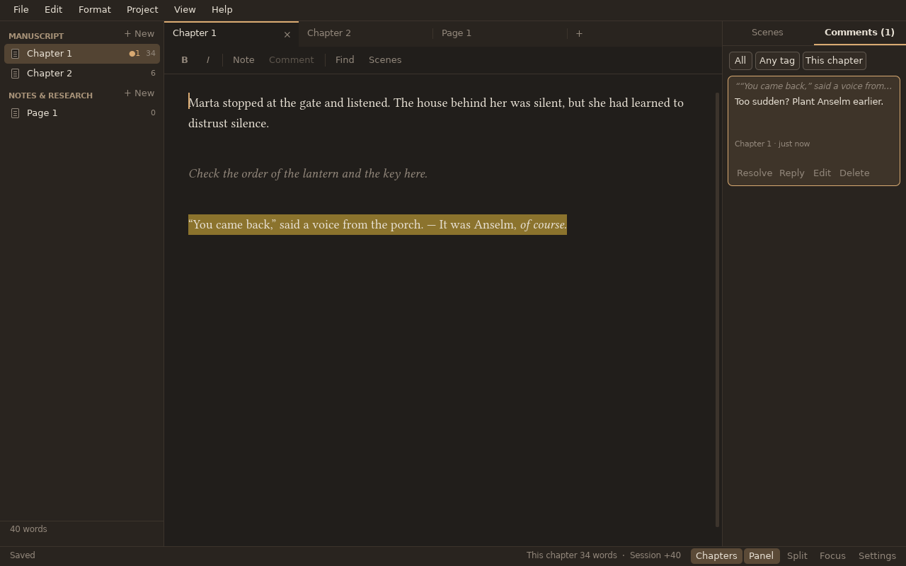

# JustWrite

A small, fast, native editor for writing a novel. No web view, no account, no cloud: one window,
your manuscript, and a file you own.

JustWrite keeps a book as a project (`.jw`, a plain ZIP) with a **Manuscript** of parts and
chapters and a **Notes & research** section of pages. It conceals the `*` and `**` markers while
you write, keeps your private notes out of the export, lets you leave review comments on passages,
keeps a history of snapshots you can compare and restore, and exports to a manuscript in Word, a
print-ready PDF, an EPUB 3 or plain text, with a paged preview inside the app.



## Writing

* **Prose, not markup.** `*italic*` and `**bold**` show as italic and bold with the marks
  concealed (Ctrl+M shows them). A line holding `#` or `***` shows as a centred symbol you choose.
  Chapters have no headings; the tree holds their titles.
* **Typography.** Smart quotes, `--` to an em dash, `...` to an ellipsis and the Spanish dialogue dash
  as you type, all switchable per project. The project language (English or Spanish) sets the quote
  style, the spelling dictionary and the hyphenation of exports.
* **Notes.** Type `$$` and the rest of the line is a note; `a $$ note $$ b` is an inline note; lines of
  `$$$` fence a block note. `\$$` is a literal. Ctrl+/ turns the line or selection into a note and
  back, Ctrl+Alt+/ the whole paragraph. Notes are grey and italic (colour and style are settings),
  Ctrl+Shift+Y hides them, they never count as words, and they are stripped on export unless you ask
  for them. The marker is only how notes are typed: stored files are independent of it, so changing it
  in the settings updates every note.
* **Review comments.** Select text and press Ctrl+Alt+M. Comments appear as highlights and in a
  side panel with filters by status, tag and chapter; click one to jump to its text. They are stored
  outside the text and follow your edits. If the commented words are deleted the comment becomes
  *orphaned* and is kept.
* **Goals and counts.** Word counts per chapter and in total, an optional project goal and an
  optional goal per writing session.

## History

Ctrl+Alt+S takes a snapshot with a message; the program also takes automatic ones on a timer and when
the project closes. Ctrl+Shift+H opens the history: compare any two snapshots or one with the text
now (notes and comment changes can be hidden), restore the whole project or one chapter, or work on
a separate *line* (an alternate ending, say) and switch between lines. Restoring never destroys
anything; it saves what was there first and records the restore as a new snapshot. Old automatic
snapshots are thinned out; manual ones are always kept.

## Export

Ctrl+E opens the export dialog: the whole manuscript, the current chapter, chosen chapters or any
snapshot; notes stripped or kept; comments left out, as Word comments or as an appendix; title page,
contents, dedication, acknowledgments, about-the-author and copyright pages; and every layout value
(page size, margins, fonts, spacing, running heads, chapter openings, drop caps…). Save a setting
as your own preset. The built-in presets are:

| Preset | Format | |
| ------ | ------ | - |
| Standard manuscript | DOCX or PDF | 12 pt Times New Roman, double spaced, 1 inch margins, title page with contact details and rounded word count, running head, chapters a third of the way down, `#` scene breaks |
| Print book | PDF | trims from 5 × 8 to 6 × 9 or custom, mirrored margins with gutter, justified and hyphenated, running heads, drop caps, chapters on right-hand pages, bleed, fonts embedded |
| E-book | EPUB 3 | cover, metadata, navigation, a style theme; validated with EPUBCheck |
| Markdown, plain text | md, txt | |

The preview (Ctrl+Alt+P) lays the book out with the same typesetter that writes the PDF and shows
the pages in the app. Publishing details (author, ISBN, blurb, dedication…) are on the *Book
details* page in the Project menu.

## Import

File ▸ Import reads `.docx`, `.md` or `.txt` into a new or the open project. Chapters are cut at
headings, at lines matching a pattern, or at page breaks; lines that start with a marker you choose
(such as `#` or `//`) become notes; Word comments become review comments.

## Files and safety

A project is one `.jw` file, a ZIP of text and JSON ([format](docs/FORMAT.md)). While you work
JustWrite keeps an unpacked working copy with a journal and rewrites the `.jw` atomically when
you save, when you close, and every few minutes, so a crash or a power cut loses nothing. A lock file
warns you before you open a project that is already open on another computer. Everything stays on
your machine.

## Keys

Every command can be remapped (Settings ▸ Keyboard shortcuts); Ctrl is Cmd on a Mac.

| | |
| - | - |
| New chapter · note page | Ctrl+N · Ctrl+Alt+N |
| Open · new project | Ctrl+O · Ctrl+Shift+N |
| Save | Ctrl+S |
| Bold · italic | Ctrl+B · Ctrl+I |
| Note: line or selection · paragraph | Ctrl+/ · Ctrl+Alt+/ |
| Review comment · comments panel | Ctrl+Alt+M · Ctrl+Shift+M |
| Find · replace · search the project | Ctrl+F · Ctrl+H · Ctrl+Shift+F |
| Go to chapter · jump to scene | Ctrl+P · Ctrl+J |
| Snapshot · history | Ctrl+Alt+S · Ctrl+Shift+H |
| Export · preview | Ctrl+E · Ctrl+Alt+P |
| Rename · move up · move down | F2 · Alt+↑ · Alt+↓ |
| Split right · down | Ctrl+\ · Ctrl+Shift+\ |
| Hide notes · show marks | Ctrl+Shift+Y · Ctrl+M |
| Focus mode | F11 |
| Command palette | Ctrl+Shift+P |

## Building

```
cargo build --release
./target/release/justwrite            # opens the last project
./target/release/justwrite novel.jw   # opens (or creates) a project
```

Rust 2024 (1.85 or newer). On Linux you also need the usual windowing libraries (X11 or
Wayland, `libxkbcommon`) and, for the file dialogs, an XDG desktop portal. The program is a single
executable; fonts and dictionaries are embedded.

```
cargo test                           # unit tests
cargo run --release --bin performance-check   # the performance gate
justwrite --measure-startup          # first-frame time, then exits
```

The performance gate measures a keystroke through parse, shape, raster and presentation (limit
5 ms) and 60 Hz scrolling on 1 MB, 100 MB and a 10 MB single line, and, with notes, comments and
history involved, large manuscripts (hundreds of chapters) and deep history (hundreds of
snapshots). One stress case, a 10 MB single line across a 2560 × 1440 window, is held to 10 ms instead
of 5 ms because drawing its fifteen thousand glyphs alone takes more than half the budget; the
original editor this one is derived from measures the same on the same machine. See
[performance-results.json](performance-results.json).

### File association

* **Windows:** the program registers `.jw` for the current user the first time it runs
  (`HKCU\Software\Classes`); no installer is required. `packaging/windows/jw.reg` does the same by hand.
* **macOS:** `packaging/macos/Info.plist` declares the document type; `packaging/macos/bundle.sh`
  builds `JustWrite.app`. Opening a file from Finder needs the Apple-event hook that the
  windowing library used here does not yet provide on macOS; until then, dropping a `.jw` on the
  window or the Dock icon, or File ▸ Open, works.
* **Linux:** `packaging/linux/justwrite.desktop` and `justwrite-mime.xml`.

## Layout of the source

| Module | |
| ------ | - |
| `core` | the editor core: buffer, undo, notes and prose parsing, typography, comments, spelling, settings, shortcuts |
| `jw` | the project file: manifest, ZIP packing, working copy and journal, lock, book details |
| `history` | snapshots, lines, restore, comparison, pruning |
| `export` | the document model, plain text and Markdown, DOCX, EPUB 3, typesetting with Typst for PDF and preview |
| `import` | `.docx`, `.md` and `.txt` readers and the chapter splitter |
| `ui` | window, painting, the project tree, side panels, dialogs, history, comparison and preview screens |
| `render`, `fonts`, `platform` | the CPU renderer, bundled fonts, operating-system services |

## Licence

MIT. The bundled fonts (Libertinus Serif, Tinos and Courier Prime) are under the SIL Open Font
Licence and the spelling dictionaries under their own licences; see `assets/fonts/NOTICE.md` and
`assets/dictionaries/`.
